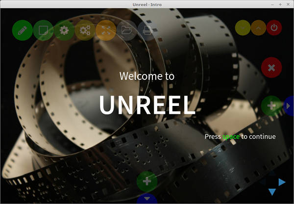

> [!CAUTION]
> This repository has been neglected for too long, and Electron has evolved and changed so much. I don't have time to rewrite this application, so it will remain archived as a reminder: don't forget to update your code frequently, otherwise it will become outdated and useless.

# Unreel

**Reveal your ideas**

A GUI to create Reveal presentations.

#### License [GPL-3+](LICENSE)

With Unreel you can create amazing REVEAL.JS presentations without knowing Web technology, thanks to Electron, Tinymce, Quicksettings and much more Open Source code...

For issues and source code you can find Unreel on [github](https://github.com/linux-man/unreel).

[Binaries and installers](https://github.com/linux-man/unreel/releases).
